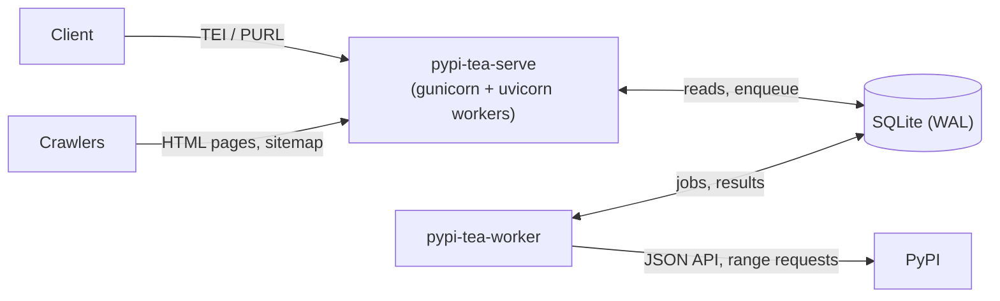

# pypi-tea

[](https://github.com/sbomify/pypi-tea/actions/workflows/ci.yaml)
[](https://pypi.org/project/pypi-tea/)
[](https://pypi.org/project/pypi-tea/)
[](https://github.com/sbomify/pypi-tea/blob/master/LICENSE)
[](https://trust.sbomify.com/component/pypi-tea/)

A [Transparency Exchange API (TEA)](https://github.com/CycloneDX/transparency-exchange-api) server that extracts and serves SBOMs from PyPI packages.

Python wheels can include SBOMs in `.dist-info/sboms/` ([PEP 770](https://peps.python.org/pep-0770/)). pypi-tea makes these discoverable through the TEA protocol — give it a PURL like `pkg:pypi/requests@2.31.0` and it returns any SBOMs found in the package's wheel files.

## How it works

1. A TEA client queries with a TEI or PURL identifier.
2. If the release is already indexed, the answer comes straight from the local SQLite store.
3. If not, the API queues it and waits briefly while the worker:
   - fetches the release from the [PyPI JSON API](https://docs.pypi.org/api/json/)
   - reads each wheel's ZIP central directory and `.dist-info/sboms/` members with HTTP range requests (a few KB per wheel, not the whole file)
   - detects and validates each SBOM's format, and checks PEP 740 attestations
4. The result is stored permanently: wheels are immutable, so a wheel is never fetched twice.

## Architecture



The service is split so that traffic can never turn into upstream work it can't afford:

- **The API process never talks to PyPI.** Every page and TEA response is built from indexed SQLite lookups. Crawlers fetching package pages, listings, the sitemap or SBOM downloads cost a millisecond each, however many arrive at once.
- **All upstream I/O happens in the worker,** at a fixed concurrency. A burst of lookups for unknown releases makes the queue longer; it does not multiply outbound connections, threads or memory.
- **On-demand lookups are bounded.** A lookup for an unknown release waits at most `PYPI_TEA_RESOLVE_WAIT_SECONDS`. Past that, or once `PYPI_TEA_MAX_PENDING_LOOKUPS` lookups are queued, the API answers `503` with `Retry-After` instead of piling up.
- **Every request has a deadline** (`PYPI_TEA_REQUEST_TIMEOUT_SECONDS`), and each API process caps open connections (`PYPI_TEA_MAX_CONNECTIONS_PER_WORKER`). Over either limit it sheds load with a fast `503` rather than stalling.
- **Responses are edge-cacheable,** with `stale-if-error`, so Cloudflare can keep serving pages through an origin restart.

### Storage

A single SQLite database in WAL mode, so any number of API processes read while the worker writes.

| Table | Contents |
|---|---|
| `releases` | One row per resolved `package@version`: upload date, trimmed PyPI metadata, whether any wheel has an SBOM |
| `wheels` | Every wheel of a release: digests, size, attestation result, and an error if it couldn't be read |
| `sboms` | Every SBOM found: format, validity, media type, SHA-256, and the content (zlib-compressed) |
| `entities` | Deterministic TEA UUID → product / release / component / artifact |
| `listing` | Materialised browse order for `/packages` and the sitemap, rebuilt by the worker. Any page is a primary-key range read |
| `jobs` | Work queue: interactive lookups (priority 0) ahead of backfill (5) and scheduled refresh (9). Claims are leases, so a crashed worker's job is picked up again |
| `missing` | Releases PyPI says don't exist, retried after an hour |
| `usage_*` | Query counters for the dashboard, buffered in memory and flushed every 10 s |

Nothing expires. The worker re-checks every known project for new releases once a week; re-resolving a known release costs one PyPI JSON request, because already-inspected wheels are reused.

### Statistics

`GET /` is a live dashboard; `GET /stats`, `/stats/timeseries`, `/stats/usage` and `/stats/invalid-sboms` return the raw JSON. They are computed from the tables above and cached for 60 s per process.

### Pages for AI agents

Every HTML page has a Markdown copy at the same URL plus `.md`, written for AI agents and LLM crawlers: `/package/<name>/<version>.md`, `/packages.md` (same `format` and `page` parameters) and `/index.md` for the dashboard. Package pages also have a JSON copy at `.json`. `/llms.txt` describes the site and these URLs.

The copies say what the page says, so they must not compete with it in search: they are sent with `X-Robots-Tag: noindex` and `Link: <page URL>; rel="canonical"`, and stay out of the sitemap. Each HTML page points at its copy with `<link rel="alternate" type="text/markdown">`, and has page tools to copy it as Markdown, view it as Markdown or JSON, or open it in Claude or ChatGPT.

## Quick start

### Prerequisites

- Python 3.14+
- [uv](https://docs.astral.sh/uv/)

### Install and run

```bash
git clone https://github.com/sbomify/pypi-tea.git
cd pypi-tea
uv sync
# API and worker in one process, for development:
PYPI_TEA_EMBEDDED_WORKER=true uv run uvicorn pypi_tea.app:app
```

The server starts at `http://localhost:8000` and writes `pypi-tea.db` in the working directory.

In production, run the two halves separately:

```bash
pypi-tea-serve      # API: one worker process per CPU
pypi-tea-worker     # ingest worker
```

### Configuration

All settings are configurable via environment variables with the `PYPI_TEA_` prefix:

| Variable | Default | Description |
|---|---|---|
| `PYPI_TEA_DATABASE_PATH` | `pypi-tea.db` | SQLite database file (shared by API and worker) |
| `PYPI_TEA_SERVER_ROOT_URL` | `http://localhost:8000` | Public root URL (used in TEA discovery responses, canonical links and the sitemap) |
| `PYPI_TEA_PYPI_BASE_URL` | `https://pypi.org` | PyPI API base URL |
| `PYPI_TEA_TEA_SPEC_VERSION` | `0.3.0-beta.2` | TEA spec version to advertise |
| `PYPI_TEA_ATTESTATION_VERIFICATION` | `true` | Verify PEP 740 attestations |
| `PYPI_TEA_BIND` | `127.0.0.1:8000` | `pypi-tea-serve` listen address |
| `PYPI_TEA_WEB_WORKERS` | `0` (one per CPU) | `pypi-tea-serve` process count |
| `PYPI_TEA_MAX_CONNECTIONS_PER_WORKER` | `512` | Open connections per API process before new ones get `503` |
| `PYPI_TEA_FORWARDED_ALLOW_IPS` | `127.0.0.1` | Proxies trusted for `X-Forwarded-*` |
| `PYPI_TEA_RESOLVE_WAIT_SECONDS` | `20` | How long a lookup for an unknown release waits for the worker |
| `PYPI_TEA_MAX_PENDING_LOOKUPS` | `500` | Queued on-demand lookups before new ones are shed |
| `PYPI_TEA_REQUEST_TIMEOUT_SECONDS` | `30` | Hard per-request deadline |
| `PYPI_TEA_WORKER_CONCURRENCY` | `16` | Releases the worker resolves at once |
| `PYPI_TEA_WHEEL_CONCURRENCY` | `4` | Wheels inspected at once within one release |
| `PYPI_TEA_EMBEDDED_WORKER` | `false` | Run the worker inside the API process (development/tests only) |
| `PYPI_TEA_POSTHOG_API_KEY` | sbomify's project key | PostHog project key for analytics; set it empty to turn analytics off |
| `PYPI_TEA_POSTHOG_HOST` | `https://us.i.posthog.com` | PostHog ingestion host |

### Analytics

pypi-tea sends usage events to [PostHog](https://posthog.com) so we can see how the service is used. Nobody signs in, so events are anonymous and create no person profiles. Server-side, a client's id is a keyed hash of its IP and User-Agent that changes daily. Neither value is sent; only the client family and version parsed from the User-Agent (`libtea`, `curl`, `browser`, ...) are.

| Event | Sent by | Properties |
|---|---|---|
| `tea_api_called` | API | `endpoint`, `status_code`, `versioned_url`, `duration_ms`, `client`, `client_version` |
| `sbom_lookup` | API | `source` endpoint, `package`, `version`, `os`, `arch`, `platform_qualified`, `has_sbom`, `wheel_count`, `sbom_count`, `sbom_formats`, `has_invalid_sbom`, `attested` |
| `sbom_lookup_failed` | API | `source`, `reason` (`invalid_purl`, `unversioned`, `unsupported_tei`, `not_on_pypi`, `pending`, `overloaded`), `package`, `version` |
| `sbom_downloaded` | API | `artifact_uuid`, `package`, `version`, `media_type`, `size_bytes` |
| `release_indexed` | worker | releases indexed because someone looked them up: `package`, `version`, `on_pypi`, `has_sbom`, `sbom_count`, `sbom_formats`, `duration_ms` |
| `$pageview`, `$pageleave` | browser | tagged with `page_type` (`dashboard`, `package`, `package_list`, `not_found`) and the page's `package`, `version`, `sbom_formats` or `filter_format` |
| `sbomify_cta_clicked` | browser | clicks through to sbomify (`cta`: `start_free`, `learn_more`, `product`, `sign_in`; `placement`: where on the site) |
| `sbom_download_clicked`, `package_clicked`, `package_list_filtered`, `package_list_paginated`, `hero_cta_clicked`, `code_copied`, `external_link_clicked`, `nav_clicked` | browser | from `data-ph-*` attributes on the clicked element |

HTML pages and SBOM downloads are mostly answered by the edge cache, so their server-side events only count cache misses. The browser events cover what visitors do on the site. To tag a new element, give it `data-ph-event="name"` and a `data-ph-<property>` attribute for each property.

Error tracking uses Sentry's own variables and applies to the API, the worker and `pypi-tea-refresh` alike (events carry a `component` tag):

| Variable | Default | Description |
|---|---|---|
| `SENTRY_DSN` | unset | Sentry DSN; unset disables error tracking |
| `SENTRY_ENVIRONMENT` | `production` | Sentry environment name |
| `SENTRY_TRACES_SAMPLE_RATE` | `0.01` | Share of requests and jobs sent as performance traces |
| `SENTRY_SEND_DEFAULT_PII` | `false` | Attach request headers and client IPs to events |

### Queue maintenance

```bash
pypi-tea-refresh --status            # queue depth per priority
pypi-tea-refresh                     # check every known project for a new release now
pypi-tea-refresh --existing          # ...and re-resolve every known release
```

### Migrating from 0.x (Redis)

Since 26.10.0 (the switch to CalVer), pypi-tea stores everything in SQLite and no longer uses Redis. To carry over the set of known releases, queue them from the old keyspace; the worker re-resolves them, releases with SBOMs first:

```bash
uvx --from 'pypi-tea[import-redis]' pypi-tea-refresh --import-redis redis://localhost:6379/0
```

While a release is still queued, its package page answers `503` with `Retry-After`, so search engines retry rather than drop it. TEA UUIDs are deterministic and unchanged, except for projects with a `.` in their name: names are now normalised as PyPI does (PEP 503), so `zope.interface` and `zope-interface` are one product, `zope-interface`, and old `/package/zope.interface/…` URLs redirect there.

## TEA endpoints

| Endpoint | Description |
|---|---|
| `GET /discovery?tei=...` | TEI-based discovery |
| `GET /products` | List or search products (`idType`, `idValue` query params) |
| `GET /product/{uuid}` | Get a product |
| `GET /product/{uuid}/releases` | List releases for a product |
| `GET /productReleases` | List or search product releases |
| `GET /productRelease/{uuid}` | Get a product release |
| `GET /productRelease/{uuid}/collection/latest` | Latest SBOM collection |
| `GET /productRelease/{uuid}/collections` | All collections |
| `GET /productRelease/{uuid}/collection/{version}` | Collection by version |
| `GET /component/{uuid}` | Get a component (wheel) |
| `GET /component/{uuid}/releases` | Component releases |
| `GET /componentRelease/{uuid}` | Get a component release with collection |
| `GET /componentRelease/{uuid}/collection/latest` | Latest collection |
| `GET /componentRelease/{uuid}/collections` | All collections |
| `GET /componentRelease/{uuid}/collection/{version}` | Collection by version |
| `GET /artifact/{uuid}` | Get an artifact (SBOM) |

### Non-TEA endpoints

| Endpoint | Description |
|---|---|
| `GET /` | Statistics dashboard (Tailwind + Chart.js) |
| `GET /package/{name}/{version}` | SBOM page for a release |
| `GET /packages` | Browse releases with SBOMs (`page`, `format` query params) |
| `GET /sitemap.xml` | Sitemap index; shards at `/sitemap-{n}.xml` |
| `GET /attestation/{package}/{version}` | PEP 740 attestation results per wheel |
| `GET /stats` | Raw statistics JSON |
| `GET /stats/timeseries` | Daily statistics (30 days) |
| `GET /healthz` | Liveness: `200` when the database is readable |

## Example

Discover SBOMs for a package:

```bash
curl "http://localhost:8000/discovery?tei=urn:tei:purl:localhost:pkg:pypi/cyclonedx-python-lib@8.4.0"
```

Search by PURL:

```bash
curl "http://localhost:8000/products?idType=PURL&idValue=pkg:pypi/cyclonedx-python-lib@8.4.0"
```

## Data model

| PyPI Concept | TEA Entity | UUID derived from |
|---|---|---|
| Package (e.g. `requests`) | Product | `uuid5(NS, "pkg:pypi/requests")` |
| Version (e.g. `2.31.0`) | ProductRelease | `uuid5(NS, "pkg:pypi/requests@2.31.0")` |
| Wheel file | Component + ComponentRelease | `uuid5(NS, "wheel:<filename>")` / `uuid5(NS, <wheel_url>)` |
| SBOM file in wheel | Artifact | `uuid5(NS, "sbom:<wheel_url>:<sbom_path>")` |

All UUIDs are deterministic (UUID v5 with a fixed namespace) so they're stable across requests and server restarts.

## Deployment

A systemd setup is included in `deploy/`:

```bash
sudo ./deploy/setup.sh 26.10.1    # installs into /opt/pypi-tea, enables both services
sudoedit /etc/default/pypi-tea   # PYPI_TEA_SERVER_ROOT_URL=https://tea.example.com
sudo systemctl restart pypi-tea pypi-tea-worker
```

The services run from a fixed virtualenv, so restarts don't depend on PyPI being reachable. The database lives in `/var/lib/pypi-tea/`.

Logs:

```bash
journalctl -u pypi-tea -f
journalctl -u pypi-tea-worker -f
```

## Development

```bash
# Install dev dependencies
uv sync --group dev

# Run tests (no services needed; the conformance suite reaches live PyPI)
uv run pytest

# Lint
uv run ruff check src/ tests/

# Format
uv run ruff format src/ tests/

# Type check
uv run mypy src/
```

### Conformance

The test suite runs [libtea's conformance checks](https://pypi.org/project/libtea/) against an in-process server. 21 of 26 checks pass; 5 CLE (Collection Lifecycle Event) checks are skipped as CLE is not implemented.

## Versioning

Versions are CalVer, `YY.M.PATCH`, matching the other sbomify projects: the two-digit year and month of the release, then a counter that restarts at 0 each month. Releases are tagged `vYY.M.PATCH` (for example `v26.10.0`). 26.10.0 follows 0.6.2, so version ordering still holds for pip and uv.

## License

Apache-2.0
